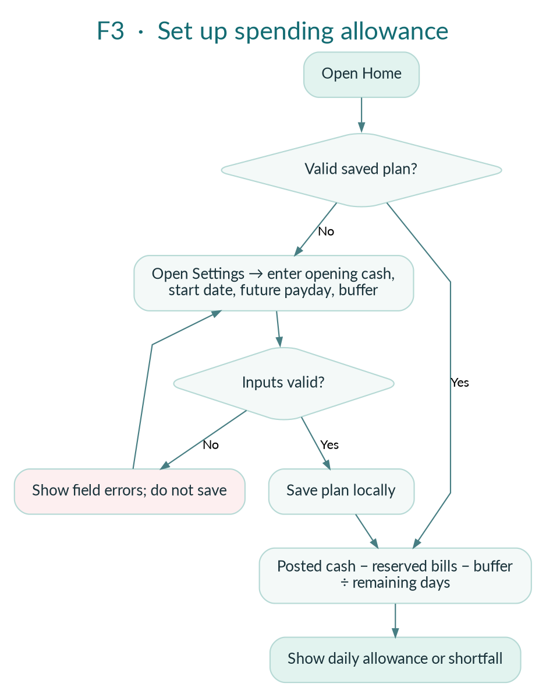
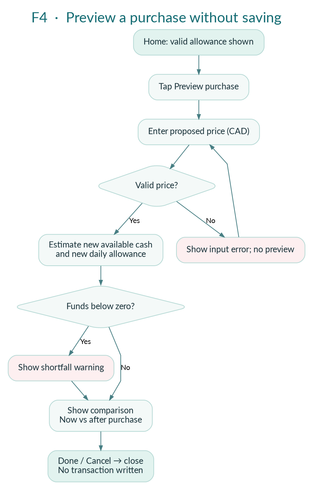
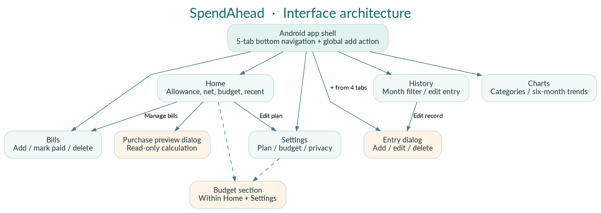
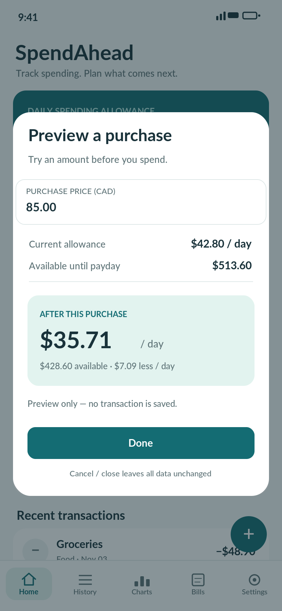
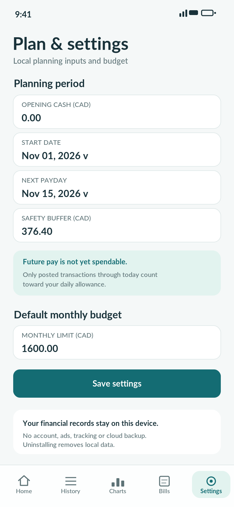

# SpendAhead — Phase 2 design: Pin Hung Chiang's assigned portion

**Course:** CPRG-303-A Mobile Application Development | **Team:** Group 1
**Repository:** `rahulisbest7o5-boop/Expense-Tracker-App`
**Status:** Draft for peer review; not yet verified against a running Android app.

This folder contains the **planned M1 design deliverables**, aligned with the team's earlier Phase 1 charter. The diagrams and screens are **design proposals**, not finished Kotlin implementation. They were prepared with AI assistance and should be reviewed, edited as appropriate, and disclosed consistent with SAIT/course requirements. The GitHub commit author should reflect the person who actually uploads or revises the files; teammate approval must not be claimed without evidence.

## Owned deliverables

| ID | Description | Primary asset | Stories |
|---|---|---|---|
| F3 | Set up and calculate daily allowance UX flow | [F3 diagram](flows/F3_Daily_Allowance.png) | US05, US07 |
| F4 | Preview a purchase without writing a transaction | [F4 diagram](flows/F4_Purchase_Preview.png) | US08 |
| IA | App information architecture and screen navigation | [Navigation diagram](flows/Navigation_Architecture.png) | US01–US10 |
| S07 | Purchase Preview dialog mockup | [S07 mockup](mockups/07_purchase_preview_dialog.png) | US07, US08 |
| S08 | Planning & Settings mockup | [S08 mockup](mockups/08_planning_settings.png) | US03, US05, US07, US10 |

PNG provides a visual preview. SVG is editable vector design. DOT is editable Graphviz flow source.

## User flow: F3 — Daily allowance

1. User opens Home.
2. If a valid planning setup is absent, navigate to Settings to enter opening cash, start date, future payday, and buffer.
3. Validate dates and nonnegative numeric inputs; show inline errors instead of saving invalid data.
4. Persist valid settings locally.
5. Calculate available money from posted cash, minus outstanding bill reserves and buffer, then divide by remaining days.
6. Show an amount per day or a clearly labeled shortfall; do not count future expected income as cash.

**Alternative paths:** unconfigured plan, expired payday, invalid values, negative available cash.

## User flow: F4 — Purchase preview

1. From Home with a configured plan, tap **Preview purchase**.
2. Enter a hypothetical CAD price; reject zero, negative, or otherwise invalid input.
3. Compute before-and-after available cash and daily allowance.
4. Show a shortfall warning if the purchase would exceed available funds.
5. The Done/Cancel action closes the dialog and **never saves the preview as a transaction**.

## App architecture

- **Five bottom navigation tabs:** Home, History, Charts, Bills, Settings.
- **Shared Add Transaction:** entry dialog reachable from primary sections.
- **Home:** balance and allowance overview, budget summary, preview dialog and planning shortcuts.
- **History:** month-specific transactions and edit/delete dialog.
- **Charts:** category breakdown and six-month comparison.
- **Bills:** outstanding bills and paid state.
- **Settings:** planning inputs, budget default, privacy note.
- Budget detail is inside Home/Settings, not a sixth tab.

## Two screen mockups

**S07 — Purchase Preview**

Includes purchase amount input, comparison of cash and allowance now versus after purchase, invalid-input feedback, shortfall messaging, and Done/Cancel. Preview is non-destructive and clearly shows CAD units.

**S08 — Planning & Settings**

Includes opening cash, start date, future payday, buffer, default budget, Save settings, and local/offline privacy explanation. Invalid or expired date combinations need explicit errors.

## Alternate states

- [S07 purchase shortfall](mockups/states/S07_purchase_shortfall.png) shows an $86.40 shortfall when a $600.00 purchase is previewed against $513.60 available. Closing the preview returns to Home.
- [S08 invalid payday](mockups/states/S08_invalid_payday.png) keeps the prior plan until the user corrects the payday and saves.

## Design and decision rationale

- **Separation of responsibilities:** users edit plan assumptions in Settings; Home displays computed results.
- **Avoid misleading balances:** monthly net and spendable cash are labeled differently.
- **Read-only preview:** a hypothetical purchase cannot pollute transaction history.
- **Accessibility:** provide text and numeric results alongside colors; aim for clear labels and sufficiently large touch targets.
- **Offline-first:** no bank sync, ads, account, payments, or app-store publishing in this project scope.

## Reviews and evidence still needed

- [ ] Amanuel verifies linked bills/reserves and cash calculation assumptions.
- [ ] Rahul checks visual consistency with other team mockups, typography, colors, navigation.
- [ ] Group confirms naming, screen transitions, and accepted work allocation.
- [ ] Group validates actual submitted format and Phase 2 deadline on Brightspace.
- [ ] Actual author, revisions, date, PR and reviewer comments are logged.

_This README is a proposed design explanation. It is not proof of classmate approval, Android build success or completion of other members' work._
